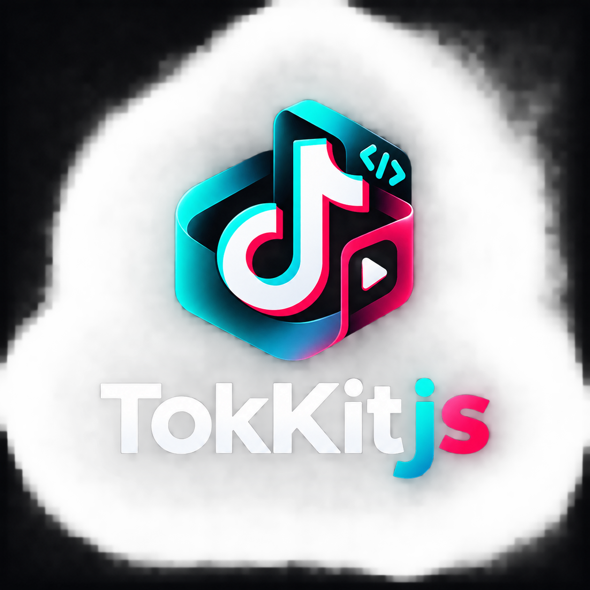

<!-- BADGE LINKS -->
[npm]: https://www.npmjs.com/package/@odion-cloud/tokkit.js
[actions]: https://github.com/odion-cloud/Tokkit.js/actions
[license]: LICENSE

<div align="center">
  <br/>
  <p>
    <a href="https://github.com/odion-cloud/Tokkit.js">
      
    </a>
  </p>
  <p>A comprehensive, modular TypeScript client for TikTok's internal Web & Gateway APIs.<br/>Works seamlessly on Node.js, Deno, Bun, and modern browsers.</p>

[][actions]
[][npm]
[][license]

</div>

## Features

- 🔓 **No authentication required** — auto-acquires device identity and session tokens
- 🎬 **Direct Video Stream Resolver** — extract direct HTML5-playable MP4 CDN streams without auth
- 🎭 **Short Drama Portal** — trending, ranking, latest releases, genre filters, and episode playlists
- 🔍 **Explore, Live & Music** — browse 21 explore categories, search live streams, and discover music tracks
- 🧩 **Strict TypeScript** — complete typings and autocomplete support
- 📦 **Zero Runtime Dependencies** — pure ESM package

## Installation

```bash
# NPM
npm install @odion-cloud/tokkit.js

# Bun
bun add @odion-cloud/tokkit.js

# Deno
deno add npm:@odion-cloud/tokkit.js
```

## Basic Usage

```ts
import { TokKit } from '@odion-cloud/tokkit.js';

// Initialize client session
const tokkit = await TokKit.create();

// Browse TikTok Short Drama portal
const dramas = await tokkit.getDramaTrending();
console.log(`Found ${dramas.items.length} drama series`);

// Resolve direct video streams
const video = await tokkit.resolveVideo('https://www.tiktok.com/@user/video/1234567890');
console.log('Playable MP4 URL:', video.streamUrl);
```

For complete documentation, guides, and interactive examples, visit the [TokKit Documentation](https://github.com/odion-cloud/Tokkit.js#readme).

## Contributing

All contributions are welcome, big or small. If you want to contribute, take a look at the [issues page](https://github.com/odion-cloud/Tokkit.js/issues) and our [guidelines](CONTRIBUTING.md).

## Disclaimer

This project is not affiliated with, endorsed, or sponsored by TikTok, ByteDance, or any of their affiliates or subsidiaries. All trademarks and logos are the property of their respective owners.

## License

Distributed under the [MIT](LICENSE) License.
